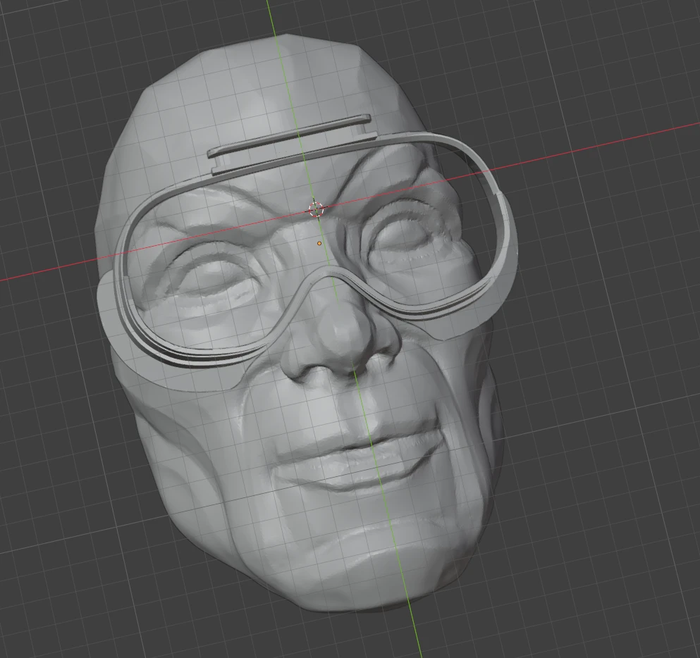

# Custom-fit VR face gaskets

Scan your face with your phone, shape a VR face gasket around it in Blender, and 3D print it in soft TPU. The result is a cushion that follows your own face: less light leaking in, less pressure on the cheekbones and forehead, and a better fit if the stock one never sat right.

Everything here is free except the filament.

<!-- PHOTO: finished gasket on the headset, next to the stock one -->

## What you need

| | |
|---|---|
| **Phone** | Any phone that can run [Polycam](https://play.google.com/store/apps/details?id=ai.polycam) |
| **Software** | [Blender](https://www.blender.org/) and [Bambu Studio](https://bambulab.com/en/download/studio) (free) |
| **Base gasket** | A face gasket model for your headset from [Printables](https://www.printables.com/) |
| **Printer** | A printer that handles TPU. I used a Bambu Lab printer |
| **Filament** | 95A TPU for the soft cushion, PLA for the mount if it needs to be stiff |
| **Drying** | A filament dryer, or a printer that can dry filament |
| **Glue** | For joining a PLA mount to a TPU cushion |
| **Finishing** | Flush cutters, sandpaper (fine grit) |

## Steps

1. [Scan your face](steps/1-scan.md) with Polycam
2. [Shape the gasket in Blender](steps/2-blender.md) and export an STL
3. [Print it](steps/3-print.md) in TPU (and PLA where needed)
4. [Finish and test the fit](steps/4-finish.md)

## Print settings at a glance

| Setting | Value | Why |
|---|---|---|
| Material | 95A TPU, dried at 55 °C for 6 h | Soft and flexible; dry filament prints clean |
| Walls | 1 | A thin shell squishes instead of pressing |
| Infill | 7% | Low infill keeps it soft |
| Orientation | 45°, face side up | Avoids long overhangs on the curve and gives a clean surface where it touches your face |
| Supports | On (tree supports) | Needed for the angled overhangs |

## Folders

- `steps/`: the step-by-step guide
- `files/`: models and Bambu Studio project files (coming)
- `gallery/`: photos of results (coming)

## Safety

The gasket sits on your skin, so:

- Sand every edge that touches your face smooth.
- Wipe it clean after use. TPU can be cleaned with mild soap and water or alcohol-free wipes.
- Stop using it if it irritates your skin.
- Make sure it doesn't push your eyes closer to the lenses than the stock gasket does.
