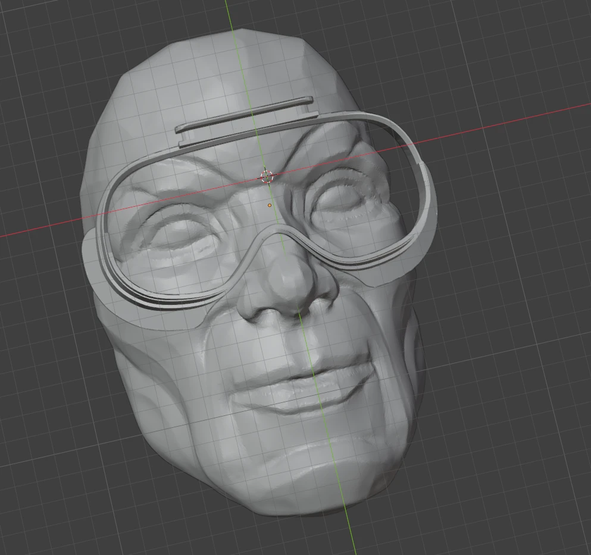

# 2. Shape the gasket in Blender

Here you cut your face shape into a gasket model, so the cushion follows your face.

## Get a base gasket

Download a face gasket for your headset from [Printables](https://www.printables.com/). Pick one that already fits your headset well.

> **Only edit the side that faces you.** Leave the mounting part, the clips or screw points that attach to the headset, exactly as it is. If you change it, the gasket won't fit the headset anymore.

## Import

1. Open Blender and delete the default cube.
2. **File → Import** the face scan (OBJ / STL / glTF).
3. **File → Import** the base gasket STL.

## Scale the face scan (very important)

The scan from your phone isn't guaranteed to be the right size, and a wrong scale ruins the whole fit.

1. Measure something on your real face, for example the distance between your pupils or the width across the cheekbones.
2. Measure the same thing on the scan in Blender.
3. Scale the scan until they match. Use **Scale** with the numbers, not by eye.

## Line them up

1. Use your reference photos of you wearing the headset. They show how the headset really sits: how high, how tilted, and how far from the face.
2. Place the face scan behind the gasket the same way, with your eyes at the lens position.
3. Push the face into the gasket. **How far you push decides how much cushion and support you get:**
   - Pushed in more: firmer, more support, tighter seal.
   - Pushed in less: softer, lighter touch.

   Start with a few millimetres and adjust after a test print.

## Cut your face shape in

1. Select the gasket and add a **Boolean** modifier.
2. Set it to **Difference** and pick the face scan as the object.
3. Apply the modifier, then hide or delete the face scan.
4. Check the result for holes or stray bits, and clean them up.

## Split into two parts (if needed)

If your gasket screws onto the headset or needs to be stiff, split it in two:

- **PLA**: the part that mounts to the headset. It holds its shape and the screws grip it.
- **TPU**: the part that touches your face.

Cut the model into two objects where the mount ends and the cushion begins. You'll glue them together after printing.

## Export

1. Select the gasket (or each part on its own).
2. **File → Export → STL**, with "Selection only" ticked.
3. Export one STL per part.

Next: [Print it](3-print.md)
