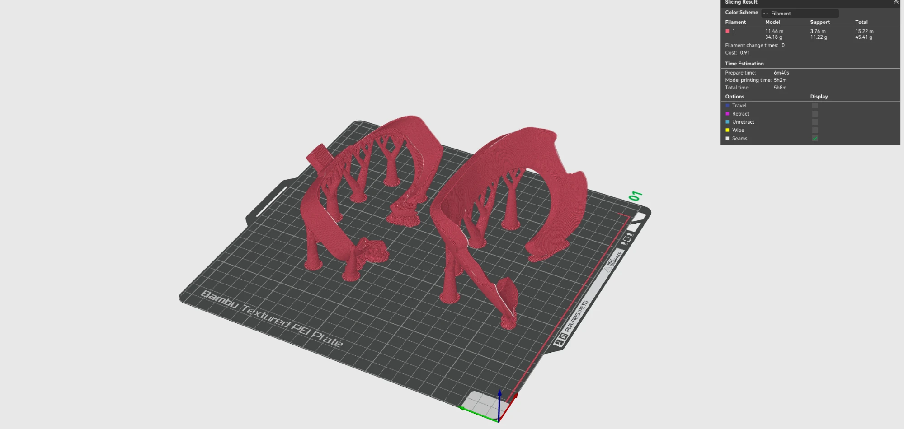

# 3. Print it

Load the STL into [Bambu Studio](https://bambulab.com/en/download/studio) (or your own slicer) and print it in TPU.

## Dry the TPU first

TPU soaks up moisture from the air. Wet TPU strings, bubbles and prints rough surfaces.

**Dry it at 55 °C for 6 hours** before printing, in a filament dryer or the printer's drying function.

## TPU settings

| Setting | Value | Why |
|---|---|---|
| Material | 95A TPU | Soft and flexible against the skin |
| Walls | 1 | A thin shell squishes instead of pressing |
| Infill | 7% | Low infill keeps the cushion soft |
| Orientation | 45°, face side up | Avoids long overhangs on the curve and keeps the surface that touches your face clean |
| Supports | On (tree supports) | Needed for the angled overhangs |

Want it softer? Lower the infill. Too floppy? Raise it a little.

*Example: two halves on one plate with tree supports. About 34 g of TPU for the model and 11 g for supports, around 5 hours of printing.*

## PLA parts

If you split the gasket in Blender, print the mounting part in PLA with normal settings. It doesn't need to be soft, it needs to hold its shape, fit the headset and hold the screws.

## TPU tips

- Print TPU slowly. Fast printing makes soft filament jam.
- Keep the spool dry while printing, too. A dry box helps on long prints.

<!-- TODO: failed prints and what I changed -->

Next: [Finish and test the fit](4-finish.md)
